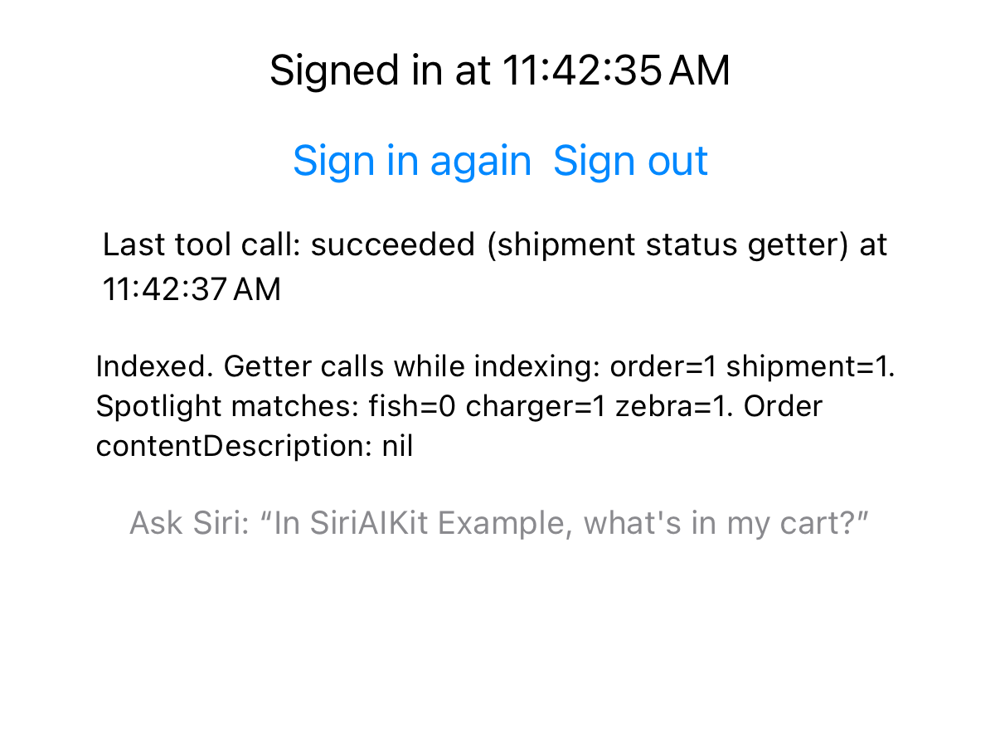

# Spike: `@DeferredProperty` and the indexing rule

**Status:** done. SDK reading, a Simulator index probe, and a device run on Nov 12, 2026 (section 4).
**Probe:** `OrderProbe.swift` and `OrderProbeEvaluationTests.swift`, removed from the example after the device run because the probe's getter wrote to the example's outcome log (issue #26). They're in git history before that removal.

SyrupAIKit's rule is to index what identifies a record (id, name, synonyms) and never the answer the tool exists to give. If the answer is indexed, Siri answers from Spotlight and never calls the tool. The question here is whether an App Intents entity with an identity-only index and an async `@DeferredProperty` for the answer lets Siri answer live without a tool, and whether giving that property an `indexingKey` brings the stale answer back.

## Short answers

1. **Forms and availability:** confirmed from the iOS 27.3 SDK (below). The getter is an `async throws` accessor that the system calls on demand, in the app's process. On the device, Siri never answered from a deferred property that wasn't indexed (section 4).
2. **Does `indexingKey` index the deferred value?** **Yes.** On the Simulator, `indexAppEntities` ran the getter and Spotlight then held the live value. A deferred property with an `indexingKey` is indexed like a stored one, so it brings back the stale answer. Indexing also ran the getter of the deferred property *without* a key, but didn't store that value in Spotlight.
3. **Better pattern or complement?** **A complement.** Use the entity for lookup and a tool for the answer. A deferred property doesn't replace a tool.

## 1. What the 27.3 SDK declares

Source: `iPhoneOS27.3.sdk/.../AppIntents.swiftmodule/arm64e-apple-ios.swiftinterface` (Xcode 27.3, 27C5020n).

| Form | Availability |
|---|---|
| `@DeferredProperty()`, `@DeferredProperty(title:)` | `anyAppleOS 26.0` |
| `@DeferredProperty(indexingKey:)`, `@DeferredProperty(title:indexingKey:)` | iOS, macOS, visionOS 26.0 |
| `@DeferredProperty(title:description:authenticationPolicy:visibility:)` (all defaulted to `nil`) | `anyAppleOS 27.3` |
| `@DeferredProperty(title:description:authenticationPolicy:visibility:indexingKey:)` | iOS, macOS, visionOS 27.3 |

- There's no `customIndexingKey:` form of `@DeferredProperty`. `@ComputedProperty` has one, and so does the underlying `EntityProperty(identifier:…customIndexingKey:asyncGetter:)` init.
- New in 27.3: `IntentVisibility` (`.default` and `.internal`) and a per-property `authenticationPolicy`. For example, a status could require an unlocked device without gating the whole entity.
- The `EntityProperty` inits that take an `asyncGetter:` are the runtime form the macro targets (27.0 for entity-valued properties, 27.3 for general ones).
- Macro rules, from the diagnostics in `libAppIntentsMacros.dylib`: stored properties are rejected, and synchronous getters get "use @ComputedProperty". `@DeferredProperty` needs an `async` getter, and `get async throws` compiles.
- The macro adds a stored peer (`_status`), which **replaces the struct's memberwise init**, so write an `init(id:)` yourself. This was the first compile error.
- In the compiled metadata (`Metadata.appintents/extract.actionsdata`), a deferred property is `"capabilities": 2`, which matches `EntityPropertyModifiers.async`; a stored `@Property` is `0`. Adding `indexingKey` adds `"spotlightAttributeKey": "contentDescription"`. The system therefore knows statically which properties are async and which map to Spotlight.
- `IndexedEntity.attributeSet` and `defaultAttributeSet` are synchronous, so they can't contain a deferred value. The probe confirms that `defaultAttributeSet.contentDescription` is `nil`. Any indexing of a deferred value has to happen inside the async `indexAppEntities`, and it does.

The swiftinterface doesn't say when Siri calls a getter. That needs the device run.

## 2. Simulator probe: does `indexingKey` index the deferred value?

`OrderProbe.run()` runs on every launch. It deletes and re-indexes one of each entity, counts getter calls during `indexAppEntities`, then runs an in-app `CSSearchQuery` for each entity's marker word:

| Entity | Status property | Marker (source) |
|---|---|---|
| `OrderEntity` (id 3) | `@DeferredProperty`, no key | "fish" (DummyJSON cart 3) |
| `ShipmentEntity` (id 2) | `@DeferredProperty(…indexingKey: \.contentDescription)` | "charger" (cart 2) |
| `ReceiptEntity` (id 9), control | stored `@Property(indexingKey: \.contentDescription)` | "zebra" (constant) |

Result (iOS 27.3 Simulator, private device, deleted afterwards):

```
Indexed. Getter calls while indexing: order=1 shipment=1.
Spotlight matches: fish=0 charger=1 zebra=1. Order contentDescription: nil
```



- **Positive control:** zebra=1, so the query finds a value that's known to be indexed.
- **Negative control:** fish=0, so the query can return no. On the first run this query hung instead of returning 0, which is why the probe now gives up after 10 seconds and reports `timeout`.
- **charger=1:** the deferred value with a key was fetched from the API at index time and stored in Spotlight. The Spotlight logs agree: the shipment donation is about 218 bytes bigger than the order donation (1238 vs 1020 bytes).
- **order=1:** indexing calls *every* deferred getter, keyed or not. The order's value never reached the Spotlight item, but it was computed. Two consequences:
  - Indexing N entities costs N live API calls, possibly while the app is in the background with an expired token.
  - Indexing also donated each entity to Biome (`AppIntentsIndexedEntity`). The Simulator can't show whether the un-keyed value travels with that donation or is cached anywhere Siri reads. The device run has to settle it.

## 3. What the device run must answer

`OrderProbeEvaluationTests.swift` has two evaluations, 5 runs each. The harness waits for the "Indexed…" label, so each run starts after a fresh index.

1. **`readsDeferredPropertyLive()`** asks "In SyrupAIKit Example, what's in order 3?" and expects Siri to find `OrderEntity` 3 and say "fish". The only source of "fish" is the getter, so a passing reply means Siri read the deferred property. To tell *live* from *a value computed at index time and cached*, read each run's outcome attachment. It should be `succeeded (order status getter) at <time>`, with a time after the run started. Indexing finishes before the run, so a later time means the getter ran for Siri.
   - Pass, with the getter timed during the run: **deferred properties give live answers.**
   - Pass, with the getter last run at index time: Siri used a cached value, and the property is no better than indexing it.
   - Fail: Siri doesn't read deferred properties, or doesn't resolve the entity. `foundEntities` tells which.
2. **`answersIndexedDeferredProperty()`** asks the same question about shipment 2, as the control for the stale-answer rule. A pass with no shipment-getter call during the run means Siri answered from Spotlight. That's expected after section 2, and it confirms the rule extends to deferred properties.

Also note whether Siri ever calls `GetCartIntent` for these questions. It reads cart 1, so it can't supply either marker. And `syrup-ai-eval summarize` can't flag "answered without the tool" for these runs, because the scenarios expect no intent. Read the outcomes it prints instead.

## 4. Device run

Nov 12, 2026, iPhone 16 Pro on iOS 27.3 beta, Xcode 27.3 beta (27C5020n), example app at 0.3.0. Five runs each. Two of the ten runs ended before all their results arrived, and aren't counted.

| Evaluation | Complete runs | Reply check | Siri's reply |
|---|---|---|---|
| Order 3: deferred property, not indexed (marker "fish") | 4 | 0 of 4 | Cart 1's contents, in `GetCartIntent`'s words: "Your cart has 4 products, $13,037.88: Blue Frock, …" |
| Shipment 2: deferred property with `indexingKey` (marker "charger") | 3 | 3 of 3 | "Shipment 2 contains a Man Short Sleeve Shirt and an Apple iPhone Charger." |

The `foundEntities` check failed in both evaluations.

What it shows:

- **Siri didn't read the deferred property that wasn't indexed.** Asked about order 3, it gave cart 1's contents in every complete run. The reply text and the recorded outcome (a plain "succeeded", with no getter note) match `GetCartIntent`. `summarize` listed no tool calls for these runs, so that match is inferred, not asserted. Either way, the only source of "fish" was never used.
- **Siri did answer from the indexed one.** The getter runs when the app indexes at launch, so the outcome's time can't separate a live read from the Spotlight copy. Since Siri never read the unindexed property, the Spotlight copy is the likely source. That's the stale answer the rule warns about.

## Recommendation

- **Never put an `indexingKey` (or `customIndexingKey`) on a property that holds the answer, including `@DeferredProperty`.** Indexing fetches the value and stores it, so the answer goes stale, and the device run shows Siri uses it.
- **The entity is a complement, not a replacement.** An `IndexedEntity` with an identity-only index (id, title, synonyms) lets Siri resolve "order 3" or "my order". A `@AppIntent(.tool)` that takes the entity as a parameter gives the answer through `SiriTool`, which provides the timeout, the failure replies and the outcome log, and which Siri Evaluations can assert with `Calls`.
- **Don't rely on a `@DeferredProperty` for answers.** Siri didn't read one live in this run.
- **Worth adding:** a lint or `summarize` check that warns when an entity property with `"capabilities": 2` also has a `spotlightAttributeKey` in `extract.actionsdata`.

## Device command

This needs the probe files from git history. Keep the phone unlocked, on power and quiet.

```bash
xcodebuild test -project Example/SyrupAIKitExample.xcodeproj -scheme SyrupAIKitExampleEvals \
  -destination 'id=<device UDID>' -allowProvisioningUpdates DEVELOPMENT_TEAM=<team ID> \
  -only-testing:'SyrupAIKitExampleEvals/readsDeferredPropertyLive()' \
  -only-testing:'SyrupAIKitExampleEvals/answersIndexedDeferredProperty()' \
  -resultBundlePath deferred.xcresult
swift run syrup-ai-eval summarize deferred.xcresult
```
